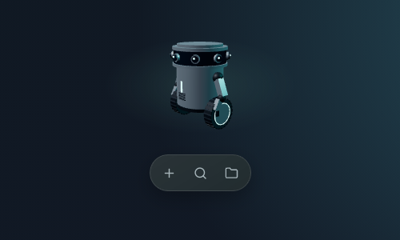
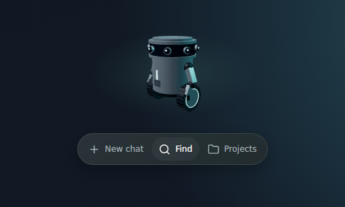
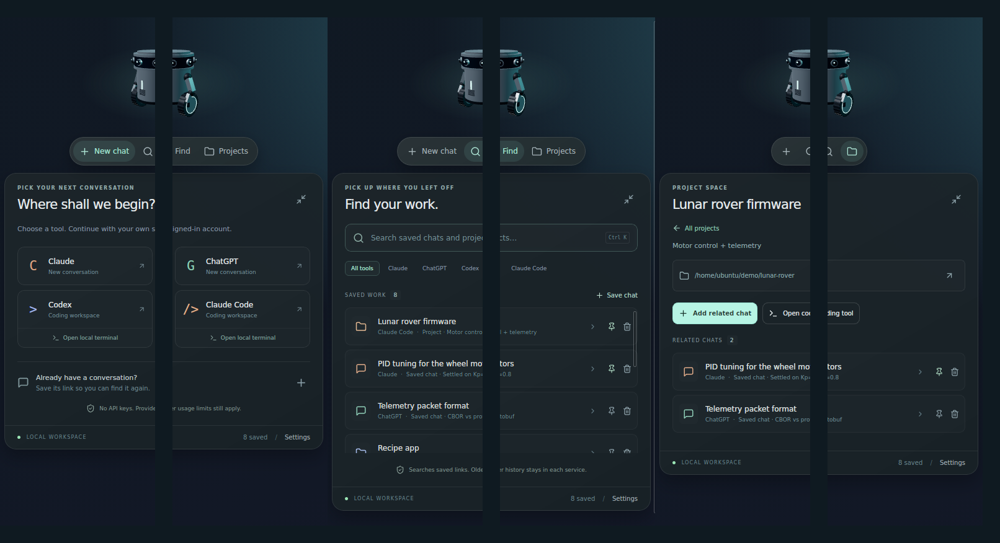

<div align="center">


# Orbit

**A tiny robot on your desktop that starts, finds and organises your AI chats.**

Claude · ChatGPT · Codex · Claude Code, with your own subscriptions. No API keys.

[](https://github.com/xingh/orbit/releases/latest)
[](https://github.com/xingh/orbit/actions/workflows/ci.yml)


**[⬇ Download Orbit](https://github.com/xingh/orbit/releases/latest)**

</div>

---

## Why Orbit?

Your AI conversations are scattered across browser tabs, apps and terminals. Orbit sits quietly in a corner of your screen and keeps them one click away.

| | |
| --- | --- |
| 💬 **New chat in one click** | Open Claude, ChatGPT, Codex or Claude Code on their official sites, already signed in as you. |
| 🔎 **Find anything you saved** | Save a conversation link once, then search it by title, note, tool or project. Press **Ctrl/Cmd + K** to search. |
| 📁 **Projects that remember** | Keep a folder and its related chats together. Open the folder or launch your coding tool right there. |
| 🛡 **Your subscription, never an API bill** | Orbit never asks for API keys. Claude Code and Codex launch only when they are signed in with your plan. |
| 🖥 **Everywhere you work** | Native app for Windows, macOS and Linux. Small, always on top, and out of the way. |
| 🔒 **Local and private** | Everything is stored on your computer. No account, no cloud, no tracking. |

## See it

<table>
  <tr>
    <td align="center" width="50%"><br/><b>Resting</b>: just the robot and a small pill</td>
    <td align="center" width="50%"><br/><b>Hover</b>: the pill shows its labels</td>
  </tr>
</table>

<p align="center"></p>

<table>
  <tr>
    <td align="center"><b>New chat</b><br/>Pick a tool and continue with your own sign-in.</td>
    <td align="center"><b>Find</b><br/>Search saved chats and projects, filter by tool.</td>
    <td align="center"><b>Project space</b><br/>Folder, coding tool and related chats together.</td>
  </tr>
</table>

## Download

Grab the file for your computer from the **[latest release](https://github.com/xingh/orbit/releases/latest)**:

| Your computer | File to download |
| --- | --- |
| 🪟 Windows 10 or 11 | `Orbit_…_x64-setup.exe` |
| 🍎 Mac with Apple chip (M1 or newer) | `Orbit_…_aarch64.dmg` |
| 🍎 Mac with Intel chip | `Orbit_…_x64.dmg` |
| 🐧 Linux (any distro) | `Orbit_…_amd64.AppImage` |
| 🐧 Ubuntu / Debian | `Orbit_…_amd64.deb` |

<details>
<summary><b>Not sure which Mac you have?</b></summary>

Apple menu → **About This Mac**. "Chip: Apple M…" means Apple chip; "Processor: Intel" means Intel.
</details>

### First launch

The builds aren't code-signed yet, so your computer may warn you the first time:

- **Windows:** "Windows protected your PC" → **More info** → **Run anyway**.
- **Mac:** drag Orbit into **Applications** and open it. If macOS blocks it, open **System Settings → Privacy & Security** and click **Open Anyway**.
- **Linux AppImage:** right-click → **Properties** → allow running as a program, then double-click.

### Everyday use

- **Hover** the pill to see the labels, and **click** one to open its panel. Click it again, or click the robot, to tuck it away.
- **Drag** the robot, or any empty spot on the open panel, to move Orbit anywhere on screen. A quick click on the robot still opens and closes the panel.
- **Ctrl + Shift + Space** (**Cmd + Shift + Space** on Mac) shows or hides Orbit from anywhere. It is also in the tray / menu bar.

## How Orbit protects your subscriptions

Orbit opens the **official** websites and the **official** local tools. It never calls model APIs, never stores passwords or cookies, and never asks for API keys.

Before launching **Claude Code** or **Codex** in a project folder, Orbit asks the tool how it is signed in (`claude auth status`, `codex login status`):

| Tool reports | Orbit does |
| --- | --- |
| Signed in with your Claude / ChatGPT plan | Opens a terminal in the project folder and starts the tool |
| Signed in with an API key | Doesn't launch. Explains how to switch, and offers the web version |
| Signed out, or not installed | Doesn't launch. Shows how to sign in or install |
| Anything unclear | Doesn't launch. Offers the web version |

API-key environment variables (`ANTHROPIC_API_KEY`, `OPENAI_API_KEY`, …) are removed from anything Orbit starts.

## Build from source

You need [Node.js 22+](https://nodejs.org), [pnpm](https://pnpm.io), [Rust](https://rustup.rs) and the [Tauri prerequisites](https://v2.tauri.app/start/prerequisites/) for your OS.

```sh
pnpm install
pnpm tauri dev      # run the desktop app
pnpm tauri build    # make an installer for this computer
pnpm dev            # browser-only preview at http://127.0.0.1:1420
pnpm build && pnpm test && cargo test --manifest-path src-tauri/Cargo.toml
```

Built with React, TypeScript, Three.js, Tauri 2 (Rust) and SQLite. Saved work lives in your per-user app data folder (`md.tekt.orbit`).

## Releasing

```sh
git tag v0.2.0
git push origin v0.2.0
```

The **Release** workflow builds Windows, macOS (Apple Silicon and Intel) and Linux installers and publishes them on the GitHub Release for that tag. The version number comes from the tag. Every pull request also builds unsigned installers as CI artifacts.

macOS signing and notarization switch on automatically once the repo has the `APPLE_CERTIFICATE`, `APPLE_CERTIFICATE_PASSWORD`, `APPLE_SIGNING_IDENTITY`, `APPLE_ID`, `APPLE_PASSWORD` and `APPLE_TEAM_ID` secrets. Windows signing needs a code-signing certificate (not set up yet).

## Roadmap

- [x] Floating robot widget with the New chat / Find / Projects pill
- [x] Native app for Windows, macOS and Linux, with installers on every tag
- [x] Subscription check before launching Claude Code / Codex
- [ ] Database upgrades and versioned backups
- [ ] Edit saved chats and re-link moved project folders
- [ ] Signed installers (no first-launch warnings)
- [ ] Optional Grok integration beyond opening the website

## Good to know

- Find searches the links you saved in Orbit, not every past conversation in each service.
- The robot's "camera" is decoration. Orbit never uses your webcam or screen.
- Each provider's own plan limits still apply.

## Browser extension

In Chrome or Edge, open Extensions, enable Developer mode, choose Load unpacked, and select `browser-extension`. On an official conversation page, open Orbit Chat Saver and save the title/link. Export the collection, then use Orbit Preferences → Import saved work. The extension uses only active-tab metadata, local storage, and downloads. It has no background scraping, host permissions, or credential access. Transfer is currently explicit export/import, not live sync. Extension installation/testing remains manual.
