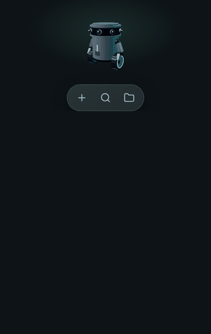
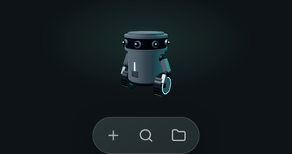
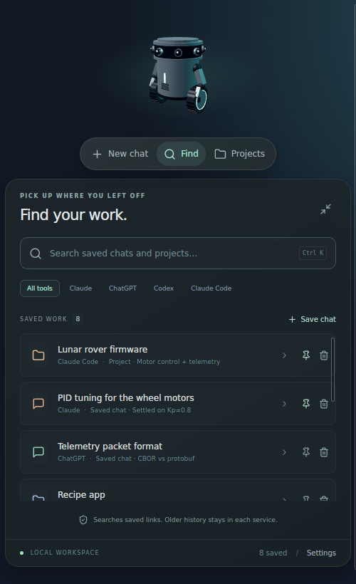
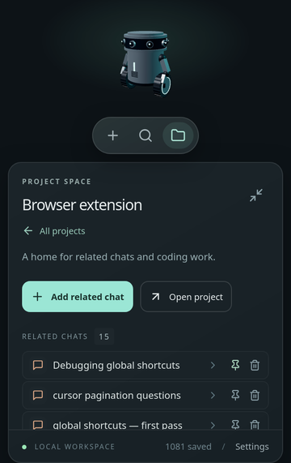

<div align="center">


# Orbit

**A tiny robot on your desktop that starts, finds and organises your AI chats.**

Claude · ChatGPT · Codex · Claude Code, with your own subscriptions. No API keys.

[](https://github.com/xingh/orbit/releases/latest)
[](https://github.com/xingh/orbit/actions/workflows/ci.yml)




**[⬇ Download Orbit](https://github.com/xingh/orbit/releases/latest)**

</div>

---

## Why Orbit?

Your AI conversations are scattered across browser tabs, apps and terminals. Orbit sits quietly in a corner of your screen and keeps them one click away.

| | |
| --- | --- |
| 💬 **New chat in one click** | Open Claude, ChatGPT or Grok on their official sites, already signed in as you. |
| 🔎 **Find anything you saved** | Save a conversation link once, then search it by title, note, tool or project. Press **Ctrl/Cmd + K** to search. |
| 📁 **Projects that remember** | Keep a folder and its related chats together. Open the folder or launch your coding tool right there. |
| 🛡 **Your subscription, never an API bill** | Orbit never asks for API keys. Claude Code and Codex launch only when they are signed in with your plan. |
| 🖥 **Everywhere you work** | Native app for Windows, macOS and Linux. Small, always on top, and out of the way. |
| 🔒 **Local and private** | Everything is stored on your computer. No account, no cloud, no tracking. |

## See it

The desktop widget at its real size — 330&nbsp;×&nbsp;529&nbsp;points, a fifth of a 13-inch screen —
holding 1081 saved chats and projects.

<table>
  <tr>
    <td align="center" width="25%"><br/><b>Resting</b><br/>the robot and its pill</td>
    <td align="center" width="25%"><br/><b>Find</b><br/>search, filter by tool</td>
    <td align="center" width="25%"><br/><b>Project</b><br/>the chats filed under it</td>
    <td align="center" width="25%"><br/><b>Robot off</b><br/>a flat mark, no renderer</td>
  </tr>
</table>

<sub>These are captured from the real build, not mocked up:
<code>docs/screenshots/capture/capture.py</code> runs it in Firefox on a virtual display with Tauri's
bridge stubbed, and drives it through Marionette. The workspace in the pictures is synthetic — it
has the same shape as a real one (1081 entries, the same split between tools) and none of its
content, because what Orbit stores is the titles of someone's conversations.</sub>

## Download

Grab the file for your computer from the **[latest release](https://github.com/xingh/orbit/releases/latest)**:

| Your computer | File to download |
| --- | --- |
| 🪟 Windows 10 or 11 | `Orbit_…_x64-setup.exe` |
| 🍎 Mac with Apple chip (M1 or newer) | `Orbit_…_aarch64.dmg` |
| 🍎 Mac with Intel chip | `Orbit_…_x64.dmg` |
| 🐧 Linux (any distro) | `Orbit_…_amd64.AppImage` |
| 🐧 Ubuntu / Debian | `Orbit_…_amd64.deb` |
| 🔗 Browser extension (Chrome / Edge) | `Orbit-Link-….zip` — see [Orbit Link](#orbit-link-the-browser-extension) |

<details>
<summary><b>Not sure which Mac you have?</b></summary>

Apple menu → **About This Mac**. "Chip: Apple M…" means Apple chip; "Processor: Intel" means Intel.
</details>

### First launch

The builds aren't code-signed yet, so your computer may warn you the first time:

- **Windows:** "Windows protected your PC" → **More info** → **Run anyway**.
- **Mac:** drag Orbit into **Applications** and open it. If macOS blocks it, open **System Settings → Privacy & Security** and click **Open Anyway**.
- **Linux AppImage:** right-click → **Properties** → allow running as a program, then double-click.

### Everyday use

- **Hover** the pill to see the labels, and **click** one to open its panel. Click it again, or click the robot, to tuck it away.
- **Drag** the robot, or any empty spot on the open panel, to move Orbit anywhere on screen. A quick click on the robot still opens and closes the panel.
- **Ctrl + Shift + Space** (**Cmd + Shift + Space** on Mac) shows or hides Orbit from anywhere. It is also in the tray / menu bar.

## Claude Code and Codex

The launcher currently shows web chat only. The native subscription gate and terminal adapters
below are built and tested, but are not offered in the UI while the browser extension and history
import settle; [issue #5](https://github.com/xingh/orbit/issues/5) tracks bringing them back.
Projects saved with a coding tool keep their **Open coding tool** button.

## How Orbit protects your subscriptions

Orbit opens the **official** websites and the **official** local tools. It never calls model APIs, never stores passwords or cookies, and never asks for API keys. The extension reads conversation and project *lists* when you ask it to import them, and never message content.

Before launching **Claude Code** or **Codex** in a project folder, Orbit asks the tool how it is signed in (`claude auth status`, `codex login status`):

| Tool reports | Orbit does |
| --- | --- |
| Signed in with your Claude / ChatGPT plan | Opens a terminal in the project folder and starts the tool |
| Signed in with an API key | Doesn't launch. Explains how to switch, and offers the web version |
| Signed out, or not installed | Doesn't launch. Shows how to sign in or install |
| Anything unclear | Doesn't launch. Offers the web version |

API-key environment variables (`ANTHROPIC_API_KEY`, `OPENAI_API_KEY`, …) are removed from anything Orbit starts.

## Project context

Orbit keeps its own context in the repository, in the [Arkitype](https://github.com/xingh/arkitype)
layout, so the thinking travels with the source even though GitHub is where work is taken in:

| Folder | What is in it |
| --- | --- |
| `.knowledge/` | What is true regardless of what is built — principles, and hard-won reference material about the providers' own endpoints |
| `.arkitype/` | How Orbit is constituted, in layers: `00` identity, `01` infrastructure, `02` database, `03` software, `04` interface |
| `.manage/` | What is to be done, one file per GitHub issue, plus `ROADMAP.md` |
| `.archive/` | What was done |

`./manage status` shows what is open. `CLAUDE.md` is the short version for an agent opening the
checkout.

## Build from source

You need [Node.js 22+](https://nodejs.org), [pnpm](https://pnpm.io), [Rust](https://rustup.rs) and the [Tauri prerequisites](https://v2.tauri.app/start/prerequisites/) for your OS.

```sh
pnpm install
pnpm tauri dev      # run the desktop app
pnpm tauri build    # make an installer for this computer
pnpm dev            # browser-only preview at http://127.0.0.1:1420
pnpm build && pnpm test && cargo test --manifest-path src-tauri/Cargo.toml
```

Built with React, TypeScript, Three.js, Tauri 2 (Rust) and SQLite. Saved work lives in your per-user app data folder (`md.tekt.orbit`).

## Releasing

```sh
git tag v0.2.0
git push origin v0.2.0
```

The **Release** workflow builds Windows, macOS (Apple Silicon and Intel) and Linux installers and publishes them on the GitHub Release for that tag. The version number comes from the tag. Every pull request also builds unsigned installers as CI artifacts.

macOS signing and notarization switch on automatically once the repo has the `APPLE_CERTIFICATE`, `APPLE_CERTIFICATE_PASSWORD`, `APPLE_SIGNING_IDENTITY`, `APPLE_ID`, `APPLE_PASSWORD` and `APPLE_TEAM_ID` secrets. Windows signing needs a code-signing certificate (not set up yet).

## Roadmap

- [x] Floating robot widget with the New chat / Find / Projects pill
- [x] Native app for Windows, macOS and Linux, with installers on every tag
- [x] Subscription check before launching Claude Code / Codex
- [x] Save straight from Chrome, Edge and Firefox into the running app
- [x] Import your existing Claude and ChatGPT web chats and projects in one click
- [ ] Per-item storage, so a renamed or deleted conversation can be kept in step
- [ ] Edit saved chats and re-link moved project folders
- [ ] One workspace API, and a workspace you can host and share
- [ ] A read-only phone client, paired by QR
- [ ] Signed installers (no first-launch warnings)

The sequenced version, with dependencies and the reasoning behind each item, is
[`.manage/ROADMAP.md`](.manage/ROADMAP.md).

## Good to know

- Find searches the links you saved in Orbit, not every past conversation in each service.
- The robot's "camera" is decoration. Orbit never uses your webcam or screen.
- Each provider's own plan limits still apply.

## Orbit Link, the browser extension

Orbit runs a small service on `127.0.0.1` while it is open, and Orbit Link saves straight into it.
Every release has it as `Orbit-Link-<version>.zip`; it is not in the browser stores yet.

Unzip it into a folder you will keep — every browser here loads the **unzipped folder**, not the
zip, and deleting the folder uninstalls the extension.

| Browser | Paste in the address bar | Then |
| --- | --- | --- |
| Chrome | `chrome://extensions` | **Developer mode** → **Load unpacked** → that folder |
| Edge | `edge://extensions` | **Developer mode** → **Load unpacked** → that folder |
| Brave | `brave://extensions` | **Developer mode** → **Load unpacked** → that folder |
| Vivaldi | `vivaldi://extensions` | **Developer mode** → **Load unpacked** → that folder |
| Opera | `opera://extensions` | **Developer mode** → **Load unpacked** → that folder |
| Firefox | `about:debugging#/runtime/this-firefox` | **Load Temporary Add-on** → the folder's `manifest.json` |

Those addresses have to be **pasted into the address bar**: no web page is allowed to link to a
`chrome://` or `about:` address, so there is nothing to click.

On Firefox the extension is **dropped every time the browser restarts**, until Mozilla signs it —
that is Firefox's rule for unsigned extensions, not a bug. Load it again from the same place.

From a checkout, load the `browser-extension` folder the same way; on Firefox choose
`browser-extension/manifest.json` inside it.

Then pair the browser once:

1. In Orbit, open **Preferences → Browser extension → Pair a browser**. Pairing stays open for 60 seconds.
2. In the browser, open Orbit Link. The first time, click **Allow Orbit access** so it may reach `127.0.0.1`, then click **Pair with Orbit**.

After that, **Save this chat** sends the title and link to Orbit and it appears in **Find** straight away.
If Orbit is closed, the chat waits in the extension and is sent the next time you open the popup with
Orbit running.

### Importing the chats and projects you already have

**Import existing chats and projects** reads your Claude and ChatGPT conversation *and* project
lists and sends every title and link to Orbit in one pass. The browser asks for access to those two
sites the first time, and the import runs in the background, so you can close the popup while it
works. Anything Orbit already has is skipped, so running it again is safe and costs nothing.

It reads only the lists — titles, ids and dates. Message content is never requested. It uses the
endpoints each site's own sidebar uses, through the session already in your browser, so nothing asks
for a password and no API key is involved.

Each service's **projects are read before its chats**, and a chat that belongs to a project is filed
under it, so opening a project in Orbit shows the conversations that live there. A chat Orbit already
had gains that link the next time you import — nothing else about it is touched, so a title you
edited or an entry you pinned stays as you left it.

The four lists are read independently, so one failing never costs the others. Three details are
worth knowing, because all three have bitten a real import:

- A Claude account usually has **more than one organization** — a Console one beside the claude.ai
  one — and only some will serve a chat list; the rest answer 403. Orbit tries every organization and
  keeps whatever answers, so a personal and a team workspace both come in.
- ChatGPT's project list is **cursor-paged**, not offset-paged. Reading only its first page is why
  an earlier import found five projects and stopped; every page is followed now.
- These endpoints are internal and can change without notice. When a list cannot be read, the import
  says which one and why, and offers **Copy import report** — a short log of each request, its
  status, and the field *names* (never values) of the first row it held. Pasting that into an issue
  is enough to fix a mapping.

Web chat only: Claude Code and Codex are launched from Orbit itself rather than saved from a
browser. [Issue #5](https://github.com/xingh/orbit/issues/5) tracks supporting them.

### What the service will and will not do

- It listens on loopback only, on the first free port in `41479–41483`.
- Every save needs the pairing token **and** a browser-extension origin, so a web page that finds the
  port cannot read or write anything.
- Only conversation titles and links are sent — never message content.
- Saving one chat uses the active tab alone. Importing your history needs access to `claude.ai` and
  `chatgpt.com`, which the browser asks for at the moment you start an import, not at install.
- An import reads from the extension first. If a list comes back empty it runs the same requests
  inside a tab on the provider, where they are same-origin with your signed-in session; a tab opened
  for that is opened in the background and closed again.
- It accepts conversations and projects only. A browser cannot pin entries or set local folders, and
  it can file a chat only under a project that is really there — a link naming anything else is
  dropped and the chat is saved loose.
- **Preferences → Forget paired browsers** gives Orbit a new token, so every browser must pair again.
- The window and the service write to the same storage. A window save keeps any entry it has not
  seen rather than overwriting it, so an import running while you work cannot lose entries.

Orbit's own **Workspace backup** export and **Import saved work** are unchanged, for moving a
workspace between computers.
